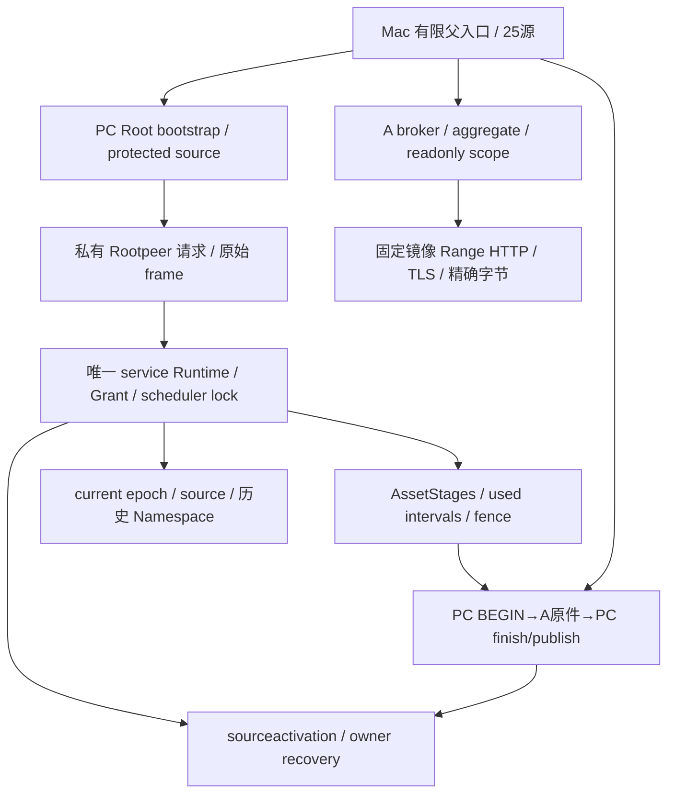

# 架构与阅读路径

## 角色与生命周期

- `runtime118/`：按当前 source118 的逐文件 SHA 匹配的真实 Python。103个 Python 文件全部覆盖；其余15项是配置、SSH、known-hosts或数据，主动排除。包含 shared scheduler / control-plane / composition / service / node adapter / collector / wiring。
- `installed/PC/`：新R16已安装控制层的脱敏源码。`service/`持有普通模型和固定资产的门、历史读取、当前源资格、维护和资源 fence；`pc/`及顶层入口负责normal/Root发布/clock等。
- `installed/A/`：A的固定镜像、broker、监督器、range transport / TLS / headers / body / EOF / SHA消费者。禁止通过本包执行下载。
- `installed/C_static9/`：独立clock probe模板；原whole10不延。旧C事件不可复用作新许可。
- `installed/owner_scope/`：新owner恢复专用只读scope。worker wrapper与body是不同SHA；完整PC BEGIN原件、A scope/ownedstop/kernel和PC finish串联。
- `parent25/`：普通固定disjoint资产的父25-source算法。Window1800、PrivateMux、Responder、精确PC5/A5/age10/whole30、typed cleanup、terminal两状态选择保留。当前所有具体许可数据已去掉。
- `parent_support/`：真实原11-support中10个Python模块；剩余JSON数据不导出。包括binding、prepared_runner、late_rpc、sealing和prebind失败路径。
- `generators/`：当前R16转发绑定、normal/owner/materializer和两级父运输派生。大量历史数据常量已缺省；原无自引用hash DAG结构可审，不能宣称脱敏SHA具备原资格。

## 正常更新与恢复的关键区别

普通normal gate默认要求无hold。当前是已确证失败资产的owner hold，存在独立typed entry，不能把general noholds门删掉。旧Runtime的close可能因active/held拒绝；顺序更新只可在精确已知退出映射、真实PIDgone/全CGempty/唯一leasefree及完整历史/源/AB/GPU资格后进入新sole。不能并行第二Manager或假finally close。

恢复保留旧failed actor、used、Root terminal/send/received/F9、deadline和failure语义。新独立有限permit及fresh paired证明只能释放管理hold，不重启旧body，不延旧工作窗。新activation intent/completed/fence与旧actor的完成链、partial commit拒绝及warm重入都属于同一原子性审查范围。

## 为什么历史链值得整体审阅

当前路径会在资格与恢复中重复进入 current epoch、normal/phase history、旧域 OldContext、source-context/完整历史原件消费者。角色隔离、私有module加载和exact source pins提供保护，但递归加载/compile与重复验证可能进入30秒deadline关键路径。需要分清可安全固定的历史事实与必须fresh的当前权限、资源和时钟，不能用未经证明的缓存授权替代fresh gate。
